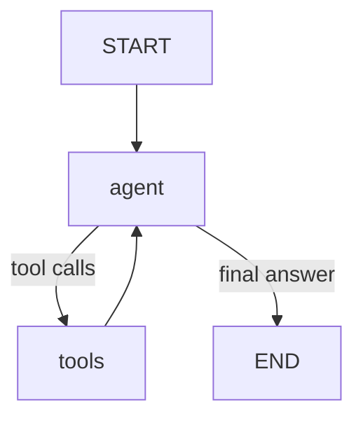

# LangGraph Architecture

## Purpose

LangGraph orchestrates the AI workflow. FastAPI calls `run_agent_graph`
as the primary AI entry point. The following sections describe the retained
Day 16 routing graph; the Day 17 tool loop is documented below.

LangChain continues to provide:

- chat models
- messages
- tools
- structured outputs

## State

The graph carries:

- `user_message`
- `request_id`
- `route`
- `route_confidence`
- `response`
- `tools_used`
- `error`

`EnterpriseState` defines this state in `ai/schemas/graph_state.py`.
Nodes return updates that LangGraph merges into the state.

## Nodes

- `router`: classifies the request and records routing confidence.
- `transaction`: handles requests for transaction details.
- `analytics`: handles requests for business analytics.
- `general`: answers general questions.
- `clarify`: asks the user to clarify an uncertain request.

## Flow

```text
START → router → domain handler → END
```

After the router, confidence below `0.65` selects `clarify`. Otherwise,
the graph selects `transaction`, `analytics`, or `general`.
Each handler and the clarification node lead to `END`.
The state's `route` retains the router's classification even when the
graph selects the clarification node.

Transaction handler failures return the safe error code
`transaction_handler_failed` and a service-unavailable response.
An `error_node` function exists for future explicit error paths but is
not yet connected to the graph. Raw exceptions are not stored in state.

## Design Principle

Nodes orchestrate behavior.

Tools perform approved capabilities.

Services enforce business behavior.

Repositories access data.

## Code Responsibility Map

| Location | Responsibility |
| --- | --- |
| `apps/api/` | HTTP/API boundary |
| `ai/graphs/` | Workflow orchestration |
| `ai/agents/` | Specialized handlers |
| `ai/tools/` | Capabilities exposed to the LLM |
| `services/` | Business logic |
| `services/*/repository.py` | Repository layer for data access |
| PostgreSQL | Serving data |

The repository layer currently lives inside each service rather than in
a separate top-level `repositories/` directory.

Streamlit continues to call `POST /api/v1/chat`; the API contract keeps
the frontend independent of the orchestration implementation.

## Day 17: Tool Agent Loop

FastAPI now calls `run_agent_graph` in `ai/graphs/tool_agent_graph.py`.
The Day 16 routing graph remains available for comparison, but is no longer
used by the chat endpoints. Day 17 does not classify a domain or compute route
confidence; those optional API fields are `null`.



`EnterpriseAgentState` extends `MessagesState`, whose message reducer preserves
human, AI, and tool messages throughout one graph run. The agent adds its next
AI message; `ToolNode` validates and executes the requested registered tools and
adds matching `ToolMessage` results. The next agent step sees those results and
can answer or request more tools, including multiple calls in one step.

Only the four existing read tools are registered: `get_transaction`,
`get_top_products`, `get_revenue_summary`, and `get_transaction_metrics`.
Unknown tool names return an error message and cannot execute arbitrary code.
Tool failures return a generic error to the model without raw exception details.
The system prompt requires factual enterprise answers to use tool results,
including when the user requests a guess. This is model behavior that must be
evaluated, not a guarantee supplied by graph topology.

Runs have an eight-step recursion limit. An exhausted run raises
`GraphRecursionError`; FastAPI returns HTTP 503 with a safe explanation.
`extract_tools_used` reads AI tool calls in order, retaining repeated names.
It records requests, including rejected or failed calls, rather than proving
successful execution. Tool result logs include their success/error status.

Logs include `request_id`, `node=agent`, `node=tools`, tool names and status,
and `graph=end`. They do not dump prompts, tool arguments, or tool result data.
The API returns the final AI message as `response` and the extracted names as
`tools_used`, preserving the Streamlit contract. Streaming remains the existing
completed-response NDJSON format; graph update streaming is a development tool.

Each request starts with one human message. Cross-request memory and
checkpointing are deferred to Day 18.

### Run and Test

```bash
# Live request with graph update tracing
python -m ai.examples.test_tool_graph "Show the top 5 products."

# Deterministic tests, no model/database required
python -m pytest tests/unit/test_tool_agent_graph.py tests/unit/test_chat_routes.py -v

# Live model and database evaluation
python -m pytest tests/agent/test_tool_agent_graph.py -v
```

Live tests cover general knowledge, each read capability, missing transactions,
false-data requests, comparisons, and unknown tools. They can fail when model
behavior changes, even if deterministic graph tests pass.

Reference: [LangGraph ToolNode](https://reference.langchain.com/python/langgraph.prebuilt/tool_node/ToolNode).
